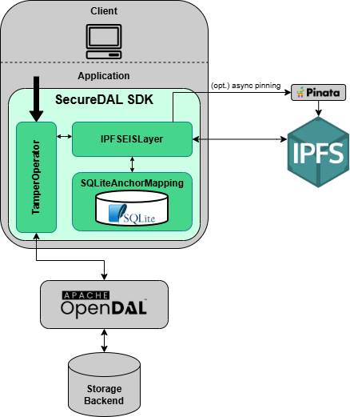

# SecureDAL

SecureDAL is an open-source Python-based SDK that extends the [OpenDAL](https://github.com/apache/opendal/tree/main) Python Binding to provide tamper detection for data stored in various backends. It is designed to be a drop-in replacement for OpenDAL, allowing developers to easily integrate tamper detection into their existing applications.

It was motivated by a Master's Dissertation on "Modular Blockchain-Based Data Tampering Detection for Storage Systems" (under review) and originated a further research paper on "SECUREDAL: A practical approach to data tampering detection" (under review).



The current implementation of SecureDAL uses [IPFS](https://ipfs.tech/) as the External Immutable Storage (EIS) layer and a local [SQLite](https://sqlite.org/) database as the mapping layer. However, the architecture is designed to be modular, allowing for the integration of different EIS and mapping layers in the future.

The repository is organized as follows:

```
SecureDAL/
├── src/securedal/          # SecureDAL source code
├── tests/                  # Test suite for SecureDAL's tamper detection validation
├── benchmarks/             # Benchmarking scripts and configurations
├── evaluation/             # Benchmarking results
├── examples/               # Example usage of SecureDAL
├── images/                 # Architecture and benchmarking process diagrams
├── README.md               # Project overview and instructions
├── INSTRUCTIONS.md         # Setup and installation instructions
├── LICENSE                 # License information
├── docker-compose.yml      # Docker Compose configuration for required services
└── pyproject.toml          # Project metadata and build configuration
```

To get started with SecureDAL, please refer to the [INSTRUCTIONS.md](INSTRUCTIONS.md) file for setup and installation instructions. For more information on how to use SecureDAL, please refer to the [examples/README.md](./examples/README.md) file.
For information on the benchmarking process and results, please refer to the [benchmarks/README.md](./benchmarks/README.md) and [evaluation/README.md](./evaluation/README.md) files, respectively. Tests information for tamper detection validation can be found in the [tests/README.md](./tests/README.md) file.

