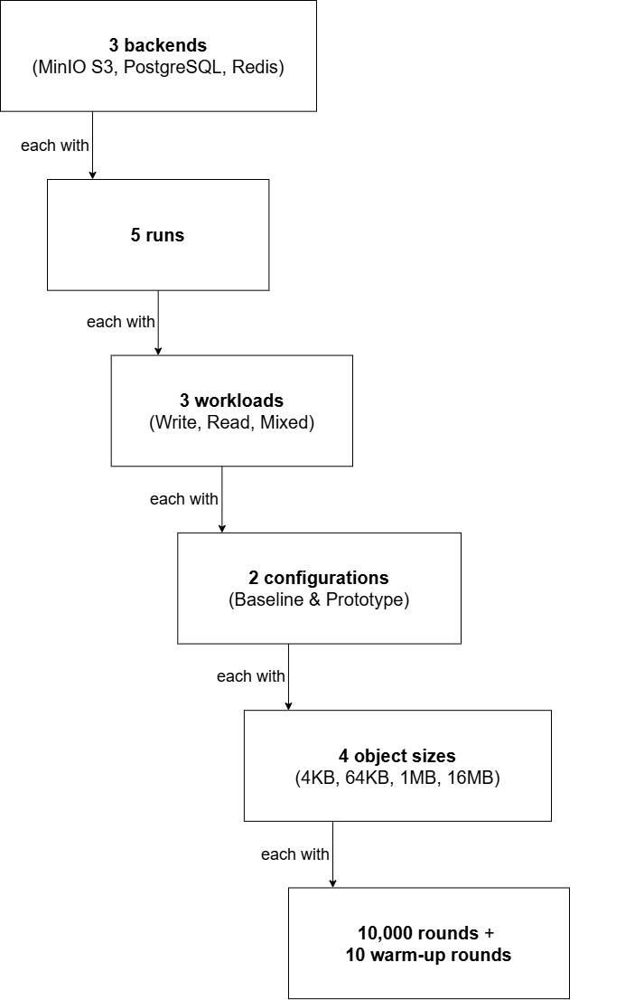

# SecureDAL Benchmark

The SecureDAL benchmarking process aims to evaluate the performance of Read and Write operations compared to the standard OpenDAL. 

The benchmarking process involves the following steps:



Benchmarks are executed using the `pytest` framework, with the `pytest-benchmark` plugin. Currently, 3 backends are set up for benchmarking: `MinIO S3`, `Redis`, and `PostgreSQL`. Both **Baseline** (standard OpenDAL) and **SecureDAL** are evaluated under **Write**, **Read** and **Mixed** (Read + Write) workloads, each executed using *10000* randomly generated objects across 4 different sizes: *1KB*, *64KB*, *1MB* and *16MB*. These sizes were inspired by the standard [OpenDAL Operations Benchmark](https://github.com/apache/opendal/tree/main/core/benches/ops). This process is repeated for *5* runs.

All these details can be altered in the [`benchmarks/run_benchmarks.sh`](./run_benchmarks.sh) script or in the benchmark configuration file [`benchmarks/conftest.py`](./conftest.py) (for modifying the sizes).

## Running the Benchmark

Before running the benchmark, ensure that you have the SecureDAL package installed. You can follow the instructions in the [INSTRUCTIONS.md](../INSTRUCTIONS.md) file to set up your environment.

1. Start the required services using Docker Compose:

   ```bash
   # From the repository root directory
   docker compose up -d
   ```

2. Run the benchmark script:

   ```bash
   # From the repository root directory
   chmod +x benchmarks/run_benchmarks.sh
   uv run ./benchmarks/run_benchmarks.sh
   ```

   Or without `uv`:

   ```bash
   ./benchmarks/run_benchmarks.sh
   ```

The results will default to the [`evaluation/final_results`](../evaluation/final_results) directory.